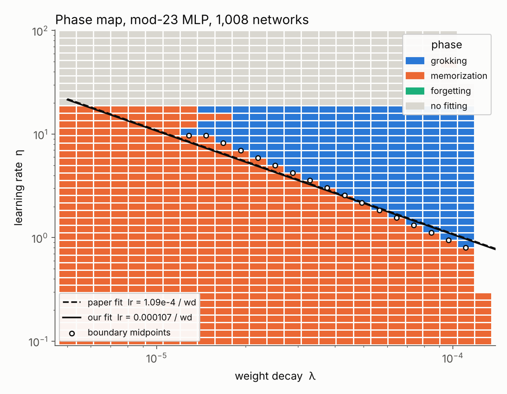

# Replicating "A Spectral Theory of Grokking" on a CPU

An independent replication of **A Spectral Theory of Grokking: Weight Decay induces Feature Learning**
(Pracher, de Jong, Lieshaus, Jeffares, Rulands; arXiv [2609.26679](https://arxiv.org/abs/2609.26679), September 2026).
The authors' code was not public at the time, so everything here was rebuilt from the paper's appendix.

**Grokking** is when a network fits its training data early but only generalizes thousands of steps later.
The paper argues that weight decay leaves a small leftover error after fitting, that this error slowly grows
task-aligned features in the network's neural tangent kernel (NTK), and that the delay therefore scales as
**1 / (learning rate × weight decay)**.

## Results at a glance

See [`docs/report.html`](docs/report.html) for the full table and figures. Every number there is generated from `results/`.

| Claim | Result |
|---|---|
| Paper's grokking cell first hits 90% held-out at update 8,300 | **8,300**, exact |
| Forgetting cell: peak train acc 0.948, final 0.204 | **0.948 / 0.204**, exact |
| Grok boundary follows lr = A / wd, A = 1.09e-4 | A within ~2% of the paper |
| Grokking time ∝ 1/(lr·wd) | log-log slope ≈ 0.96, R² ≈ 0.94 |
| Task-aligned NTK keeps growing after the fit | Partly: Fourier shape forms mostly before the fit; raw strength keeps growing ~28% after it, then plateaus |
| Post-fit residual is a ridge residual (Theorem 1) | Partly: trend clear; exact only for a smooth control network, ~25% off for ReLU because SGD never becomes stationary |
| Robust across seeds | Learning-rate scaling matches in 5/5 seeds; weight-decay scaling weaker than proportional |



## Reproduce

```bash
python -m venv .venv && .venv/bin/pip install torch numpy matplotlib scipy pytest
.venv/bin/python -m pytest -q                                    # 18 tests
PYTHONPATH=src .venv/bin/python -m grok.sweep --stride 2 --workers 3   # ~4 h on 3 cores, resumable
.venv/bin/python scripts/reference_runs.py                       # Fig. 7 cells, ~2 min
.venv/bin/python scripts/ntk_mod97.py                            # Fig. 2, ~4 min
.venv/bin/python scripts/ridge_check.py                          # Theorem 1, ~15 min
.venv/bin/python scripts/ridge_control.py square 0.2 200000      # smooth control
.venv/bin/python scripts/seed_check.py                           # 5 seeds, ~5 min
.venv/bin/python scripts/make_figures.py && .venv/bin/python scripts/make_report.py
```

## Layout

```
src/grok/      data, model, trainers (reference + batched), sweep, analysis, closed-form NTK
tests/         homogeneity and Euler identity, NTK vs autograd, trainer equivalence, phase rules
scripts/       one script per claim, plus figures and report
results/       raw sweep chunks (.npz), logs, metrics.json
docs/          report.html, teaching_guide.html, replication_plan.html
paper/         text of the paper as read for this replication
```

## Notes

- The sweep uses every second point of the paper's exact 84 × 90 grid (1,890 networks), so each cell coincides with one of theirs.
- Not attempted: the Transformer sweep (paper Fig. 4) and the NTK-alignment intervention (Fig. 6).
- `docs/teaching_guide.html` explains the theory and every design decision from first principles.
